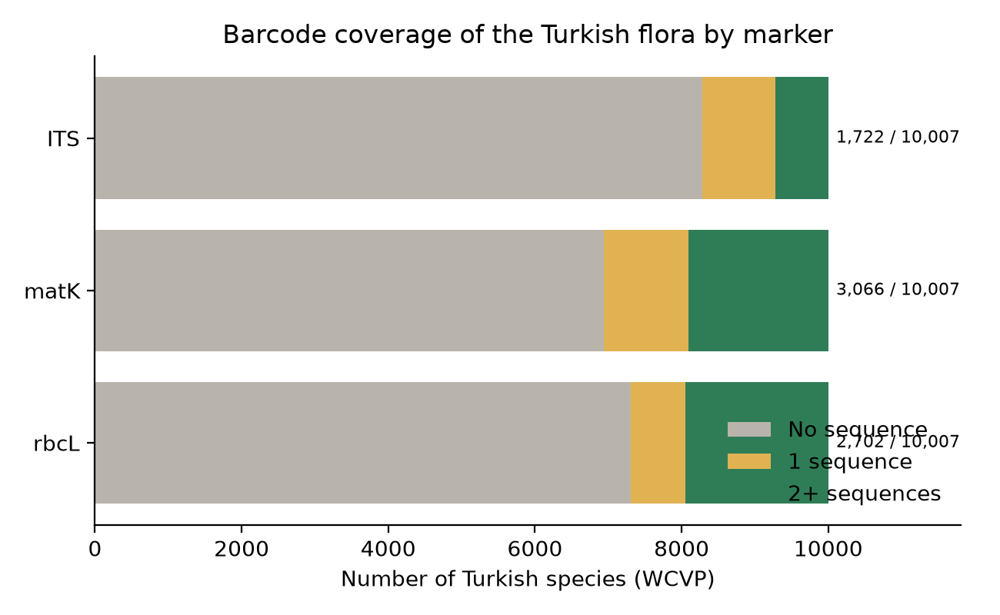
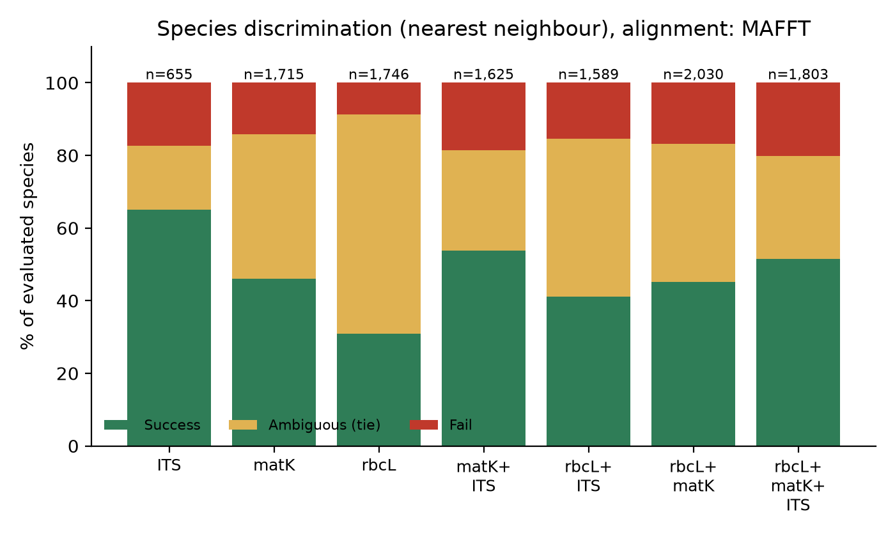
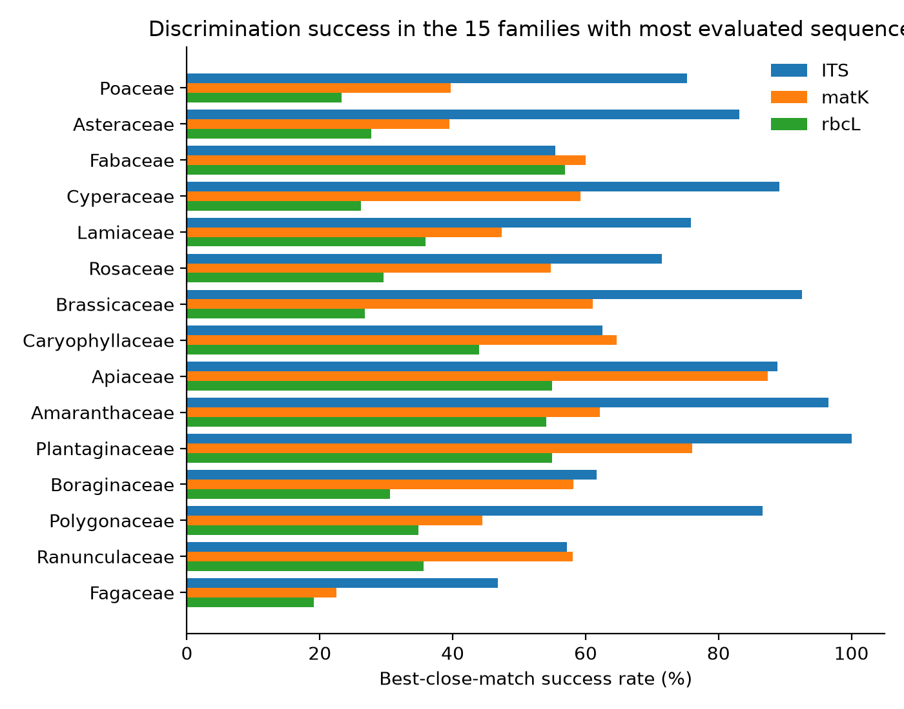
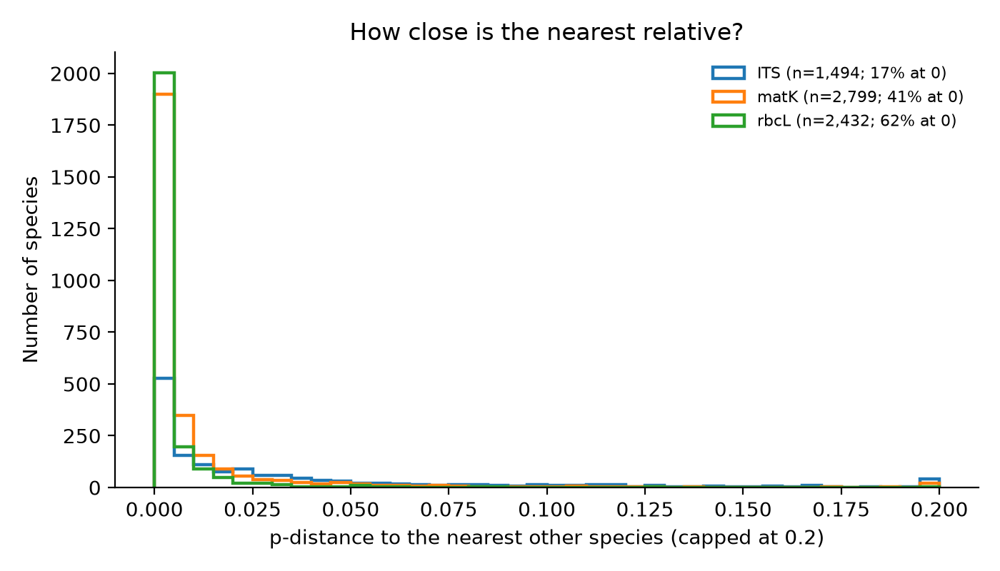
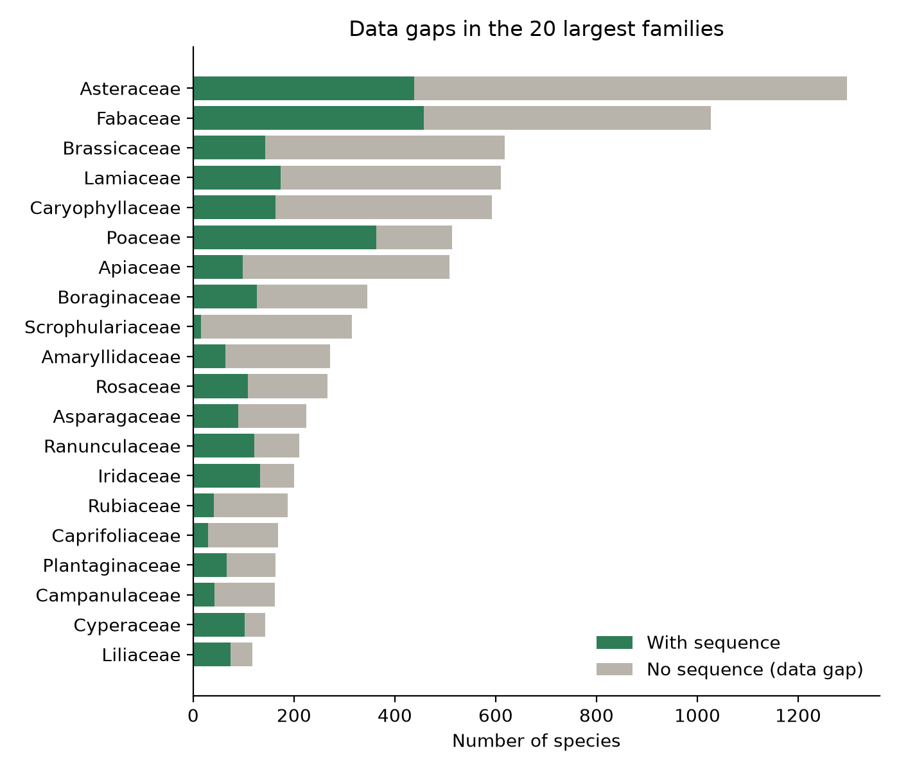

# Türkiye Bitki Florası için DNA Barkod Atlası — Rapor Taslağı

*Bu taslak `pipeline/phase6_report.py` ile 2026-11-03 tarihinde üretilmiştir. Sayılar yalnızca üretilmiş veriden gelir
(`web/public/data`, `results/`). Köşeli işaretli bölümler biyolog/danışman tarafından doldurulmalıdır.*

## Özet

Bu çalışmada Türkiye florasında doğal olarak yetişen 10.007 bitki türü (149 aile, 1.180 cins; kaynak: WCVP, Kew) için
kamuya açık DNA barkod dizileri (rbcL, matK, ITS; kaynak: ENA/INSDC) toplanmış, hizalanmış (MAFFT), komşu birleştirme (NJ)
ağaçları kurulmuş ve her markerin türleri ayırt etme başarısı ölçülmüştür. Türlerin 4.088 tanesinin (%40,9)
en az bir markerde dizisi vardır; 5.919 türün hiç dizisi yoktur. 3.472 endemik türün 3.003 tanesi
(%86,5) barkod verisinden yoksundur.
En yüksek tür düzeyi ayırt etme başarısı ITS için %65,0 (655 değerlendirilen tür) bulunmuştur.

**Anahtar sözcükler:** DNA barkodlama, Türkiye florası, rbcL, matK, ITS, veri boşluğu, endemik türler

## 1. Giriş

> **[BİYOLOG TARAFINDAN DOLDURULACAK: Literatür taraması: DNA barkodlama (CBOL Plant Working Group 2009), rbcL+matK önerisi, ITS'in bitkilerdeki rolü, Türkiye florasının zenginliği ve endemizm, mevcut barkod çalışmaları]**

**Araştırma sorusu:** Kısa bir DNA barkod bölgesi (rbcL, matK, ITS) Türkiye'de yetişen bitki türlerini birbirinden ayırmaya yeter mi? Hangi türler ve
gruplar için veri yoktur?

> **[BİYOLOG TARAFINDAN DOLDURULACAK: Çalışmanın amacı, hipotezler ve özgün değer (öğrenci/danışman)]**

## 2. Yöntem

**Tür listesi.** WCVP (World Checklist of Vascular Plants; dosya tarihi 2026-06-04, indirme 2026-11-03) kullanılmıştır. Ölçüt:
taxon_rank=Species, taxon_status=Accepted, area_code_l3=TUR, introduced=0, extinct=0, location_doubtful=0, hybrids excluded; endemic = native in exactly one WGSRPD area (TUR). Listede 10.007 tür vardır; 3.472 tanesi endemiktir (yalnızca Türkiye'de doğal).

**Diziler.** ENA Portal ve Browser API'leri kullanılmıştır (erişim tarihi 2026-11-03). Sorgular cins bazlıdır (`tax_tree`), kayıt adı WCVP kabul edilmiş
adları ve eş adlarıyla eşleştirilmiştir. Filtreler: sp./cf./aff./melez/UNVERIFIED adların atılması, marker başına uzunluk ve N oranı sınırları, aralık
bölgesi ve genom kayıtlarının atılması, aynı dizinin en çok 2 kopyası, tür ve marker başına en çok 10 dizi
(Türkiye örnekleri öncelikli). Toplam 27.823 dizi tutulmuş, bunların 1.601 tanesi Türkiye'den toplanmıştır.

**Analiz.** Her aile ve marker için hizalama (MAFFT); 400 diziden büyük aileler cins cins analiz edilmiştir.
Mesafe: p-mesafesi (en az 200 ortak baz). Ağaç: NJ. Başarı ölçütü: en yakın komşu (kendisi hariç) aynı türden ise başarılı;
marker kombinasyonları tür düzeyinde, ortak markerların ortalama mesafesiyle değerlendirilmiştir.

> **[BİYOLOG TARAFINDAN DOLDURULACAK: Yöntemin biyolojik gerekçesi ve alternatifler (ör. ML/Bayes ağaçları, BLAST tabanlı kimliklendirme)]**

## 3. Bulgular

### 3.1 Kapsam

| Marker | Dizi | Dizisiz tür | Tek dizili tür | 2+ dizili tür | Dizi düzeyi başarı | Tür düzeyi başarı | Mesafesi 0 olan tür çifti |
|---|---|---|---|---|---|---|---|
| rbcL | 12.513 | 7.305 | 742 | 1.960 | %42,1 | %26,2 | 2.771 |
| matK | 11.365 | 6.941 | 1.151 | 1.915 | %57,3 | %37,6 | 1.646 |
| ITS | 3.945 | 8.285 | 995 | 727 | %70,3 | %56,6 | 451 |

### 3.2 Ayırt etme başarısı

| Marker / kombinasyon | Değerlendirilen tür | Başarılı | Belirsiz | Başarısız | Başarı oranı |
|---|---|---|---|---|---|
| rbcL | 1.746 | 540 | 1.053 | 153 | %30,9 |
| matK | 1.715 | 791 | 680 | 244 | %46,1 |
| ITS | 655 | 426 | 115 | 114 | %65,0 |
| rbcL + matK | 2.030 | 915 | 772 | 343 | %45,1 |
| rbcL + ITS | 1.589 | 652 | 693 | 244 | %41,0 |
| matK + ITS | 1.625 | 873 | 450 | 302 | %53,7 |
| rbcL + matK + ITS | 1.803 | 928 | 513 | 362 | %51,5 |

Mesafesi 0 olan (bu markerle ayırt edilemeyen) tür çifti sayısı: 4.868 (`results/indistinguishable_pairs.csv`).

### 3.3 Veri boşlukları

En çok dizisiz türü olan 10 aile:

| Aile | Tür | Dizisi olan tür | Dizisiz tür |
|---|---|---|---|
| Asteraceae | 1297 | 438 | 859 |
| Fabaceae | 1027 | 457 | 570 |
| Brassicaceae | 618 | 143 | 475 |
| Lamiaceae | 610 | 174 | 436 |
| Caryophyllaceae | 593 | 163 | 430 |
| Apiaceae | 508 | 98 | 410 |
| Scrophulariaceae | 315 | 16 | 299 |
| Boraginaceae | 346 | 126 | 220 |
| Amaryllidaceae | 271 | 64 | 207 |
| Rosaceae | 266 | 108 | 158 |

Kapsamı en yüksek aileler (en az 20 tür):

| Aile | Tür | Dizisi olan tür | Dizisiz tür | Oran |
|---|---|---|---|---|
| Potamogetonaceae | 20 | 20 | 0 | %100,0 |
| Fagaceae | 20 | 19 | 1 | %95,0 |
| Colchicaceae | 49 | 46 | 3 | %93,9 |
| Ericaceae | 27 | 24 | 3 | %88,9 |
| Polypodiaceae | 22 | 19 | 3 | %86,4 |

Hiç dizisi olmayan en büyük 10 cins (179 cinsin hiç dizisi yok):

| Cins | Aile | Tür sayısı | Endemik tür |
|---|---|---|---|
| Dichoropetalum | Apiaceae | 18 | 9 |
| Jordania | Caryophyllaceae | 14 | 11 |
| Bufonia | Caryophyllaceae | 11 | 4 |
| Doronicum | Asteraceae | 9 | 2 |
| Knautia | Caprifoliaceae | 9 | 2 |
| Rhaponticoides | Asteraceae | 8 | 7 |
| Anisotaenia | Apiaceae | 7 | 3 |
| Ricotia | Brassicaceae | 7 | 4 |
| Echinophora | Apiaceae | 6 | 3 |
| Valerianella | Caprifoliaceae | 6 | 2 |

Hiç dizisi olmayan aile sayısı: 5. Dizisiz endemik tür sayısı: 3.003 (`results/data_gaps_endemics.csv`).

## 4. Tartışma

> **[BİYOLOG TARAFINDAN DOLDURULACAK: Bulguların yorumu: hangi markerler/kombinasyonlar neden daha iyi ayırıyor; ITS'in melezleşme/çoklu kopya sorunları; düşük başarılı grupların biyolojisi (poliploidi, hızlı radyasyon, introgresyon); literatürle karşılaştırma]**

> **[BİYOLOG TARAFINDAN DOLDURULACAK: Veri boşluklarının nedenleri ve öncelikli toplama hedefleri (endemikler, büyük cinsler)]**

## 5. Sınırlılıklar

- **Başarı yalnızca en az 2 dizisi olan türlerde ölçülür** (rbcL: 1.746, matK: 1.715, ITS: 655 tür; toplam 10.007 türün küçük bir kısmı). Tek dizili ya da dizisiz türler başarı oranına girmez; bu türler için oran bilinmemektedir.
- **Büyük ailelerde karşılaştırma cins içinde yapılmıştır** (bir markerde 400 diziden fazlası olan aileler: Asteraceae, Brassicaceae, Caryophyllaceae, Cyperaceae, Fabaceae, Lamiaceae, Poaceae, Rosaceae); cins içi karşılaştırma ailenin tamamına göre kolaydır, başarı iyimser olabilir. 737 grup (çok az dizi ya da tek tür) atlanmış, 727 grup analiz edilmiştir.
- **Diziler yalnızca %5,8 oranında Türkiye örneğidir** (1.601 / 27.823); Türkiye popülasyonlarının varyasyonu tam yansımayabilir.
- **Sürümler:** WCVP dosya tarihi 2026-06-04 (indirme 2026-11-03); ENA verisi 2026-11-03 tarihinde alınmıştır.
- **Yöntem:** p-mesafesine dayalı en yakın komşu (best close match) ve komşu birleştirme (NJ) ağaçları; hizalama: MAFFT.
- Kayıtlardaki tür adları doğrulanmamıştır; yanlış tanımlanmış diziler sonuçları etkileyebilir.
- Dizisi olmayan tür sayısı 5.919, dizisi olmayan endemik tür sayısı 3.003 (3.472 endemikten); bunlar veri boşluğudur, ayırt edilemez oldukları anlamına gelmez.
- Eşleşmeyen 33.545 farklı addan rastgele 200 tanesi sınıflandırıldı (`scripts/unmatched_sample.py`, `results/unmatched_sample_200.csv`): (a) Türkiye'de doğal olmayan kabul edilmiş tür: 179; (b) Türkiye türünün eşadı olup eşlenemeyen: 0; (c) diğer (WCVP'de olmayan ad, sp./cf., başka ülkenin türünün eşadı vb.): 21.
- Dizi arama sayfası gösterge niteliğindedir; BLAST ve uzman doğrulamasının yerini tutmaz.
> **[BİYOLOG TARAFINDAN DOLDURULACAK: Sınırlılıkların biyolojik yorumu ve sonuçlara etkisi (yanlış adlandırılmış kayıtlar, Türkiye dışı popülasyonlar, hızlı evrimleşen gruplar)]**

## 6. Gelecek çalışmalar

- Dizisiz endemik türler için arazi toplaması ve barkodlama > **[BİYOLOG TARAFINDAN DOLDURULACAK: öncelik listesi ve lojistik]**

- Ek markerler (trnH-psbA, trnL-F) ve ML/Bayes ağaçları.
- Fotoğraftan tür tanıma modülünün eklenmesi (site kodu bunun için hazırlanmıştır).
- Ulusal herbaryum örneklerinden doğrulanmış referans kitaplığı.

## Kaynaklar

> **[BİYOLOG TARAFINDAN DOLDURULACAK: Atıf listesi]**

- WCVP: Govaerts R. et al., World Checklist of Vascular Plants, Royal Botanic Gardens, Kew.
- ENA: European Nucleotide Archive, EMBL-EBI (INSDC).
